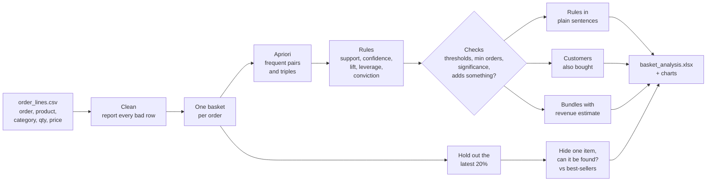
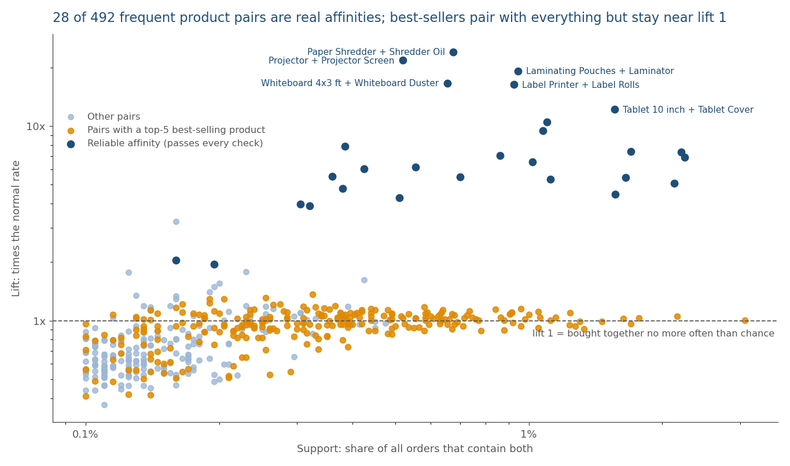
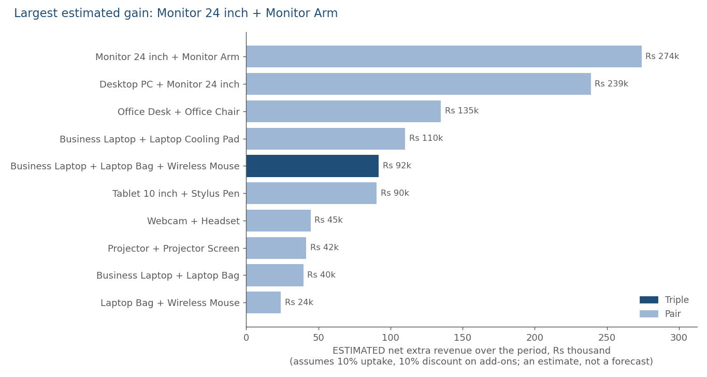
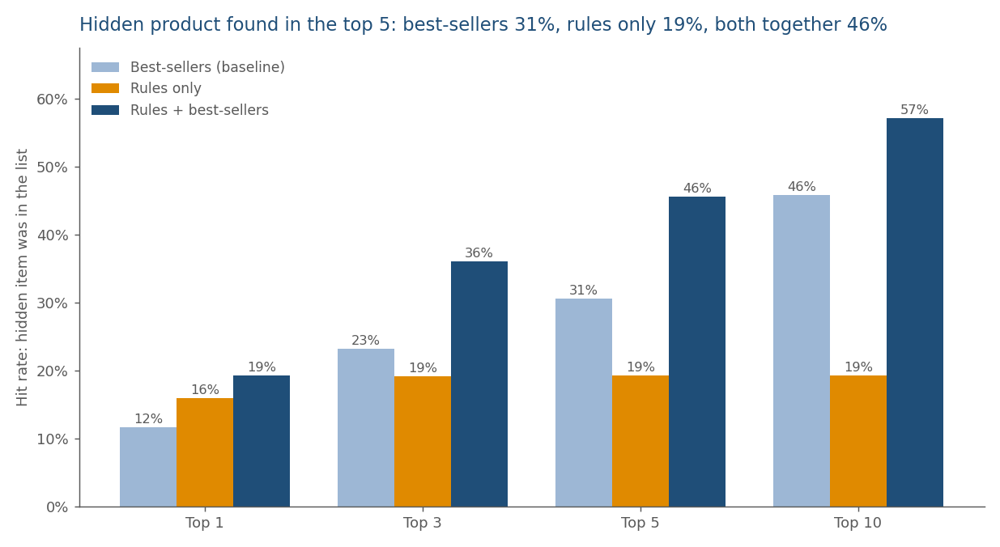

# Market Basket Analysis and Bundle Recommender (Python)

Finds which products customers really buy together, as opposed to products that just happen to land in the same order because everybody buys them, and turns that into three things a merchandiser can act on: plain-English rules, a "customers also bought" list for every product, and bundle ideas with an estimate of the extra revenue. The search for frequent combinations (Apriori) is written out in the code and tested, and the recommender is checked on orders it has never seen against a simple best-seller list.


---

## The Problem

An office and electronics retailer sells about 60 products and takes around 20,000 orders a year. The category managers decide which products sit side by side on the shelf and the website, which bundles to run, and what to show under "customers also bought". Today those choices are guesswork:

- the obvious pairs (printer and toner) are known, but nobody knows how strong they are or which weaker pairs are worth acting on
- a report that simply counts "products most often in the same order" puts A4 paper next to everything, because A4 paper is in one order in five anyway
- a pair seen in eight orders looks as convincing on a spreadsheet as one seen in eight hundred
- nobody can say whether a recommendation list would do any better than showing the best-sellers

## The Solution

```bash
python basket_recommender.py
```



1. **Read and clean** the order lines. Returns, blank products and repeated lines are reported with a reason, never dropped silently.
2. **Build one basket per order**: the set of products in it.
3. **Find frequent pairs and triples** with Apriori: count single products, keep those in enough orders, build pairs only from those, then triples only from frequent pairs.
4. **Turn them into rules** ("orders with A also contain B") and measure each one.
5. **Keep only the rules that pass every check** (below), then produce the rules table, the recommendation lists and the bundle ideas.
6. **Test honestly**: learn the rules from the first 80% of the year, then try them on the last 20%.

### Support, confidence and lift in plain words

Take 10 orders. A printer is in 4 of them, toner in 5, and both in 3. A4 paper is in 8, and paper with a printer in 3.

| Measure | Plain meaning | Printer -> Toner | Printer -> Paper |
|---|---|---|---|
| **Support** | Share of all orders that contain both | 3 / 10 = **30%** | 3 / 10 = 30% |
| **Confidence** | Of the orders with a printer, the share that also have the other item | 3 / 4 = **75%** | 3 / 4 = **75%** |
| Normal rate | Share of all orders with the other item | 5 / 10 = 50% | 8 / 10 = 80% |
| **Lift** | Confidence divided by the normal rate: how many times more likely than usual | 75% / 50% = **1.5x** | 75% / 80% = **0.94x** |
| Leverage | Support minus what chance alone would give (0.4 x 0.5 = 0.20) | 0.30 - 0.20 = **0.10** | 0.30 - 0.32 = -0.02 |
| Conviction | How much more often the rule would be wrong if the items were unrelated; 1 = no link | (1 - 0.5) / (1 - 0.75) = **2.0** | 0.8 |

Both rules have the same 75% confidence, but only toner is bought **more** often because of the printer. Paper is in 80% of all orders anyway, so a printer actually makes it slightly *less* likely. That is the best-seller trap, and it is why lift, not confidence, decides whether a link is real. These exact numbers are a unit test (`test_rule_measures_match_the_readme_example`).

### The checks every rule must pass

| Check | Default | What it guards against |
|---|---|---|
| Minimum support | 0.1% of orders | Combinations too rare to matter |
| Minimum orders | 20 orders together | A rule resting on a handful of orders |
| Minimum confidence | 10% | Links too weak to act on |
| Minimum lift | 1.5x | Best-sellers that "go with" everything |
| Significance | chi-square (Fisher's exact test when counts are small), p below 0.05 divided by the number of rules tested | Patterns that are just luck. Testing 1,374 rules at 5% each would let about 69 through by chance, so the bar is divided by the number of rules (Bonferroni correction). |
| Adds something | A two-item "if" must beat each one-item rule inside it by 5 points of confidence, and significantly | "A4 paper + shredder -> shredder oil" is just "shredder -> shredder oil" with a best-seller riding along; lift alone does not catch that |

## Results

All figures below are from `python basket_recommender.py` on the bundled sample data.

```
Input:            order_lines.csv.gz  (product level)
Orders:           19,997 (01-Jan-2025 to 31-Dec-2025), 14,509 with 2 or more items, 60 products
  ! 6 rows: Product is blank -> Left out
  ! 14 rows: Quantity is zero or negative (return or cancellation) -> Left out
  ! 10 rows: Price is missing or not positive -> Kept in the basket; not used for the typical price
  ! 8 rows: Same product listed more than once in an order -> Merged into one line (quantities added)
Rules tested:     1,374; past the thresholds: 63; also significant: 61
                  (148 more two-item rules set aside: no better than a one-item rule inside them)
```

### 1. Real affinities stand out; best-sellers do not



Each dot is a pair of products found together in at least 20 orders. **28 of the 492 pairs pass every check.** The amber dots are pairs that include one of the five best-sellers (A4 paper, pens, pen drives, notebooks, extension boards). They appear in many orders, which is why a simple "most often together" count would rank them high, but they all sit around lift 1: they are bought together with other products no more often than chance. None of them reaches the Rules, Recommendations or Bundles sheets.

**The strongest rules, in plain sentences** (from the Rules sheet):

| Rule | Orders | Test |
|---|---|---|
| 97% of orders with Whiteboard Duster and Whiteboard Markers also contain Whiteboard 4x3 ft; that is 41.8 times the normal rate (2.3%). | 59 | Fisher exact |
| 41% of orders with Paper Shredder also contain Shredder Oil; that is 24.1 times the normal rate (1.7%). | 135 | chi-square |
| 33% of orders with Projector also contain Projector Screen; that is 21.8 times the normal rate (1.5%). | 104 | Fisher exact |
| 73% of orders with Keyboard and Monitor 24 inch also contain Desktop PC; that is 20.7 times the normal rate (3.5%). | 62 | Fisher exact |
| 52% of orders with Laminator also contain Laminating Pouches; that is 19.2 times the normal rate (2.7%). | 189 | chi-square |

**What this says:** someone buying whiteboard markers and a duster is almost certainly buying a whiteboard, which is a cue for the website or the sales desk to ask. Two of the 63 rules that pass the thresholds are marked *not significant* in the sheet (for example Laptop Cooling Pad -> Wireless Mouse, 46 orders, lift 1.8) and are left out of the recommendations.

**Checking against what was planted.** The sample data has 25 planted buying patterns (`data/planted_affinities.csv`). All 8 strong and all 12 medium ones are found as rules. Of the 5 weak ones (7% to 10% of orders), 2 reach the Rules sheet; the other 3 (tablet and stylus, laptop and cooling pad, monitor and monitor arm) fall below the 10% confidence bar but are real and significant, and do show up as bundle candidates. A test checks that every strong and medium pattern is recovered.

### 2. "Customers also bought"

```bash
python basket_recommender.py --lookup "Business Laptop"
```

```
Customers who bought Business Laptop also bought:
  1. Laptop Bag                 36% of its orders, 6.9x the normal rate, 450 orders
  2. Wireless Mouse             34% of its orders, 5.1x the normal rate, 426 orders
```

```
Customers who bought A4 Copier Paper (Ream) also bought:
  (no reliable rule: nothing is bought with it clearly more often than chance)
```

The Recommendations sheet has the top 5 for every product: **38 of the 60 products** have at least one reliable recommendation. The other 22 get none rather than a made-up list; for those, the best-sellers are the honest fallback (see the evaluation).

### 3. Bundle ideas, with an estimate



| Bundle | Anchor orders | Already bought together | Near-miss orders | Net estimate (Rs) |
|---|---|---|---|---|
| Monitor 24 inch + Monitor Arm | 1,189 | 64 (5%) | 1,125 | 274,117 |
| Desktop PC + Monitor 24 inch | 704 | 224 (32%) | 480 | 238,992 |
| Office Desk + Office Chair | 449 | 111 (25%) | 338 | 135,047 |
| Business Laptop + Laptop Cooling Pad | 1,245 | 102 (8%) | 1,143 | 110,277 |
| Business Laptop + Laptop Bag + Wireless Mouse | 1,245 | 303 (24%) | 942 | 91,806 |
| ... | | | | |
| Laser Printer + Toner Cartridge | 763 | 442 (58%) | 321 | -50,370 |

**How the estimate works (and why it is only an estimate).** The bundle is offered to buyers of the most expensive item (the *anchor*). A *near-miss order* has the anchor but not every add-on. The estimate assumes **10% of near-miss buyers take the bundle**, at **10% off the add-ons**, and subtracts the discount handed to people who were buying the full set anyway. Both numbers are assumptions, not measurements; change them with `--uptake` and `--bundle-discount`. The figures cover the year in the data and are a way to rank ideas, not a forecast.

**What this says:** the best bundle ideas are real links that most buyers still miss (only 5% of monitor buyers take an arm). Printer and toner is the strongest link in the data, yet a discounted bundle *loses* money: 58% of printer buyers already take toner, so the discount mostly goes to people who would have paid full price. Put toner next to the printer; do not discount it. An uptake of 10% is generous for the monitor arm when only 5% take it today; with `--uptake 0.05` its estimate falls from Rs 274,117 to Rs 127,810.

### 4. Does it beat recommending the best-sellers?



The rules were learned from the first 15,998 orders only. From each of the 2,908 later orders with two or more items, one item was hidden at random, and each method was asked for a list given the rest of the basket. A *hit* means the hidden item was in the list.

| Method | Top 1 | Top 3 | Top 5 | Top 10 |
|---|---|---|---|---|
| Best-sellers (baseline) | 11.6% | 23.1% | 30.5% | 45.8% |
| Rules only | 15.9% | 19.2% | 19.3% | 19.3% |
| **Rules + best-sellers** | **19.3%** | **36.0%** | **45.5%** | **57.2%** |

**What this says, honestly:**

- **Rules alone are not enough.** They are right more often for the first suggestion (15.9% against 11.6%), but they only have something to say when the basket contains a product with a rule, so they stop at 19.3%.
- **Rules plus best-sellers is the useful version**: rules first where one applies, best-sellers to fill the rest. It finds the hidden item in the top 5 for 45.5% of orders, against 30.5% for the best-sellers alone.
- A rule applied in 1,914 of the 2,908 test orders (66%). In those, the combined list hit 56.0% in the top 5 against 33.2% for best-sellers; where no rule applied, the two are the same (25.4%), as they should be.
- In 29% of the test orders the hidden item is one of the five chance best-sellers (paper, pens and so on), which no basket analysis can predict from the rest of the order. A hit rate of about half is a real gain, not a near-perfect predictor.

### Category level

```bash
python basket_recommender.py --level category
```

```
Rules tested:     387; past the thresholds: 2; also significant: 2
  28% of orders with Printer Supplies also contain Printers; that is 2.7 times the normal rate (10.6%).
  50% of orders with Printers also contain Printer Supplies; that is 2.7 times the normal rate (18.7%).
...
                                top 1    top 3    top 5   top 10
  Best-sellers (baseline)       33.9%    58.2%    79.3%   100.0%
  Rules only                     5.4%     5.4%     5.4%     5.4%
  Rules + best-sellers          34.7%    60.8%    81.5%   100.0%
```

**What this says:** at category level almost every link washes out. A laptop pulls a laptop bag, but "Computers" and "Computer Accessories" are both so common that the category-level lift is only 1.44, below the 1.5 bar. Only printers and printer supplies remain. With 10 categories, best-sellers already find the hidden category in the top 5 for 79% of orders, so the rules add little (81.5%). Category analysis is useful for store layout at aisle level; product level is where the recommendations come from.

## What It Handles

| Situation | What the tool does |
|---|---|
| Your own file with other column names | `--order-col`, `--product-col` and so on, or the `columns:` block in `config.yaml` |
| No date column | Uses the order of the file for the hold-out split |
| No price column | Rules and recommendations still work; bundles need prices and are skipped |
| Returns (zero or negative quantity) | Left out, counted on the Data Issues sheet |
| Blank product or order id | Left out, counted with example row numbers |
| Missing or zero price | Line kept in the basket; not used for the typical price |
| The same product twice in one order | Merged into one line, quantities added |
| Best-sellers that co-occur with everything | Lift threshold; shown near lift 1 on the chart |
| A best-seller tagging along on a real rule | "Adds something" check on two-item rules |
| Rules resting on few orders | Minimum orders, plus chi-square or Fisher's exact test with a Bonferroni correction |
| Two add-ons linked only through a third product | Left out of bundles (laptop bag and cooling pad are linked only because both go with a laptop) |
| A product with no reliable rule | No made-up recommendations; the lookup says so |

## Output

`output/basket_analysis.xlsx` (and `basket_analysis_category.xlsx` for `--level category`):

| Sheet | Contents |
|---|---|
| Summary | Data, period, thresholds and counts |
| Rules | Every rule past the thresholds, in a plain sentence, with support, confidence, lift, leverage, conviction, p-value, test used and a significant Yes/No |
| Recommendations | Top 5 "customers also bought" per product |
| Bundles | Pairs and triples with the anchor, attach rate, near-miss orders and the revenue estimate; the assumptions are stated in red at the top |
| Evaluation | Train/test sizes, hit rates at top 1, 3, 5 and 10, and hit rates split by whether a rule applied |
| Data Issues | Every row left out or repaired, with the reason and example row numbers |

## About the Data

The 20,000 orders are made-up sample data from `make_sample_data.py` (fixed seed) for a made-up retailer, Kaveri Office & Electronics, Chennai, with 60 products in 10 categories and prices in rupees. Planted on purpose:

- **25 true affinities** of different strengths, from Laser Printer -> Toner (55% of printer orders) down to Monitor -> Monitor Arm (7%), including the laptop + bag + mouse kit; saved to `data/planted_affinities.csv`
- **five best-sellers added to orders by chance alone** (A4 paper in 22% of orders, pens, pen drives, notebooks, extension boards)
- **seasonality**: more orders in March, June and October-November, fewer on Sundays, and some categories peak in certain months
- **38 bad rows**: returns, blank products, missing prices and repeated lines

Because the patterns are planted, the results show that the method recovers them; they do not say how strong such links are in any real shop.

**Limits of the method:**

- Association rules show what is bought together, not *why*, and not what would happen if you changed prices or layout. A trial (A/B test) is the way to measure real uptake.
- The rules treat the whole year as one period. A link that only exists in the festive season is diluted; running the tool on a single quarter is a simple workaround.
- Quantity is ignored: an order with five reams of paper counts the same as one with one ream.
- The bundle estimate depends entirely on the uptake and discount assumptions.

## How to Use

```bash
pip install -r requirements.txt
```

Recreate the sample data (optional; it is already in `data/`):

```bash
python make_sample_data.py
```

Run the analysis on the sample data:

```bash
python basket_recommender.py
```

Look up one product:

```bash
python basket_recommender.py --lookup "Laser Printer"
```

Category level:

```bash
python basket_recommender.py --level category
```

Your own file, with your own column names:

```bash
python basket_recommender.py --input my_orders.csv --order-col invoice_no --product-col item_name --price-col rate
```

Stricter rules and a more cautious bundle estimate:

```bash
python basket_recommender.py --min-lift 2 --min-orders 30 --uptake 0.05
```

Run the tests:

```bash
python -m pytest
```

| Option | Default | Description |
|---|---|---|
| `--config` | `config.yaml` | YAML file with all the settings below; options on the command line win |
| `--input` | `data/order_lines.csv.gz` | Order lines, CSV or CSV.GZ |
| `--output` | `output/basket_analysis.xlsx` | Excel workbook |
| `--charts-dir` | `images` | Folder for the PNG charts (`output` at category level) |
| `--no-charts` | off | Skip the charts |
| `--level` | `product` | `product` or `category` |
| `--order-col`, `--product-col`, `--date-col`, `--category-col`, `--quantity-col`, `--price-col` | `order_id`, `product`, `order_date`, `category`, `quantity`, `unit_price` | Column names in your file; only order and product are required |
| `--min-support` | `0.001` | Minimum share of all orders with the items together |
| `--min-confidence` | `0.10` | Minimum share of A's orders that also contain B |
| `--min-lift` | `1.5` | Minimum times the normal rate |
| `--min-orders` | `20` | Minimum number of orders behind a rule |
| `--min-gain` | `0.05` | Confidence a two-item "if" must add over its one-item rules |
| `--max-items` | `3` | 2 = pairs only, 3 = pairs and triples |
| `--top-n` | `5` | Recommendations per product |
| `--holdout` | `0.20` | Share of the latest orders held out for the evaluation |
| `--uptake` | `0.10` | Bundle assumption: share of near-miss buyers who take the bundle |
| `--bundle-discount` | `0.10` | Bundle assumption: discount on the add-on items |
| `--seed` | `42` | Fixes which item is hidden in each test order |
| `--lookup` | | Print "customers also bought" for one product and stop |

The significance level (`alpha`, default 0.05) is set in `config.yaml`.

## Project Structure

```
market-basket-recommender/
├── basket_recommender.py         # Apriori, rules, checks, recommender, bundles, evaluation, Excel, charts
├── make_sample_data.py           # recreates the sample data (fixed seed)
├── config.yaml                   # column names, thresholds and assumptions
├── data/
│   ├── order_lines.csv.gz        # 20,000 orders, 46,520 lines
│   └── planted_affinities.csv    # the 25 patterns planted in the sample data
├── tests/
│   └── test_basket.py            # 9 tests
├── images/                       # charts shown in this README
├── requirements.txt
├── README.md
└── LICENSE
```

## Roadmap

- [ ] Season-by-season rules, to show which links only exist in the festive season or at year end
- [ ] Rules scored on margin as well as revenue, so bundles favour profitable add-ons
- [ ] A small Flask page where a store manager types a product and sees the recommendations

---

**Author:** [Swaminathan Narayanan](https://www.linkedin.com/in/swaminathan-narayanan-9781a7154/): Data Analytics | Excel & VBA Automation | Python | SQL | Power BI
